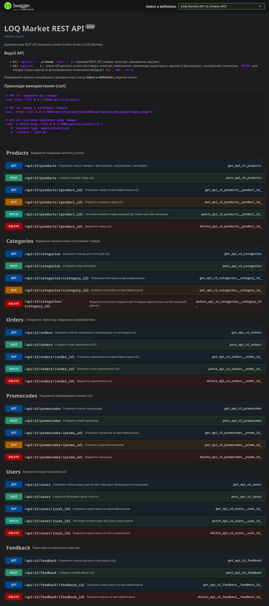
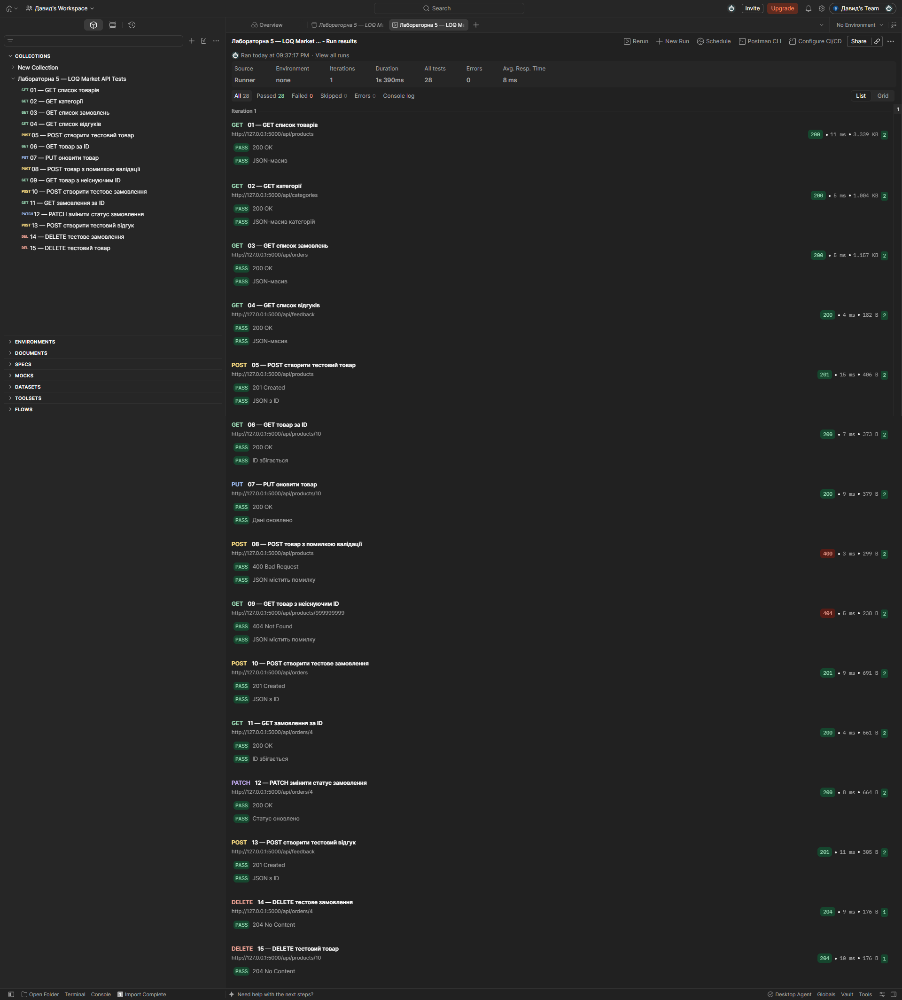

# LOQ Market (Лабораторна робота №5 — RESTful API з документацією)

Багатосторінковий вебзастосунок та версіонований RESTful API (v1 та v2) для магазину скінів Counter-Strike 2 на **Flask**, **SQLite** та **flasgger**.

## Команда

| Учасник | Роль | GitHub |
|---|---|---|
| Прадійчук Ілля Миколайович | Teamlead | https://github.com/illuwka |
| Завиднюк Влад Володимирович | Developer | https://github.com/flavour676767 |
| Біскій Давид Анатолійович | QA | https://github.com/Crunqz |

Група: **ІПЗ-22**

---

## Короткий опис проєкту та API

Застосунок **LOQ Market** поєднує вебінтерфейс на Jinja2 (каталог скінів, оформлення замовлень, обране, кабінет користувача, зворотний зв’язок і адмін-панель) із **RESTful JSON API** у двох версіях:

- **API v1 (`/api/v1/...`, а також сумісний префікс `/api/...`)** — базовий API з **13 endpoints** (товари, категорії, замовлення, відгуки) і базовим форматом помилок `{"error": "..."}`.
- **API v2 (`/api/v2/...`)** — повний API з **30 endpoints** для всіх ресурсів БД (товари, категорії, замовлення, промокоди, користувачі, відгуки), підтримкою фільтрації, сортування, пагінації, часткового оновлення (`PATCH`) товарів і користувачів, строгою валідацією вхідних даних та деталізованими JSON-помилками з кодами статусу (`400`, `404`, `405`, `409`, `415`, `422`, `500`).
- **Stateless-архітектура**: API не використовує сесії/cookies, кожен запит містить усі потрібні дані; кожна відповідь містить заголовок `X-API-Version` (`1.0` або `2.0`).
- **Інтерактивна документація Swagger (OpenAPI 2.0)** за допомогою `flasgger` на `/apidocs/` з перемикачем версій між **API v2** (`/apispec_v2.json`) і **API v1** (`/apispec_v1.json`).

---

## Використані технології

- **Python 3**
- **Flask 3.1.3** — вебфреймворк і маршрутизація (Blueprints)
- **Werkzeug 3.1.9** — обробка HTTP-винятків (`HTTPException`) та перевірка паролів
- **flasgger 0.9.7.1** — генерація OpenAPI-специфікацій (`/apispec_v1.json`, `/apispec_v2.json`) та Swagger UI (`/apidocs/`)
- **SQLite (`sqlite3`)** — реляційна база даних (`instance/loq_market.sqlite3`)
- **HTML5 / Jinja2 + Tailwind CSS 4 (CDN)** — інтерфейс вебсторінок

---

## Структура проєкту

```text
lab05/
├── app.py                   # Точка входу Flask, Swagger (flasgger), глобальні JSON-обробники для v1/v2
├── init_db.py               # Скрипт ініціалізації таблиць БД
├── seed_data.py             # Початкові дані (товари, категорії, промокод LOQ10, замовлення)
├── requirements.txt         # Залежності Python (Flask, Werkzeug, flasgger)
├── models/                  # Модулі доступу до даних SQLite
│   ├── __init__.py
│   ├── db.py                # З'єднання з БД, схема таблиць і міграції
│   ├── catalog.py           # Категорії, товари, обране
│   ├── users.py             # Користувачі, ролі, автентифікація
│   ├── orders.py            # Замовлення, позиції, статуси та промокоди
│   └── feedback.py          # Відгуки користувачів
├── routes/                  # Маршрути (Flask Blueprints)
│   ├── __init__.py
│   ├── api_common.py        # Спільні валідатори, пагінація, формати помилок і обробка sqlite3.Error
│   ├── api.py               # REST API v1 (/api/v1/* та /api/*) + конфігурація і схеми Swagger
│   ├── api_v2.py            # Повний REST API v2 (/api/v2/*) на 30 endpoints
│   ├── auth.py              # Вхід, реєстрація, налаштування адміна, кабінет
│   ├── shop.py              # Магазин, обране, оформлення замовлення
│   ├── feedback.py          # Контакти та форма зворотного зв’язку
│   └── admin.py             # Адмін-панель (товари, категорії, користувачі, замовлення, промокоди, відгуки)
├── postman/                 # Колекції тестів Postman / Bruno
├── templates/               # HTML-шаблони Jinja2
├── instance/
│   └── loq_market.sqlite3   # База даних SQLite (створюється автоматично)
├── lab-reports/             # Звіти учасників команди та скріншоти
└── README.md
```

---

## Запуск проєкту

1. Клонуйте репозиторій та перейдіть у директорію проєкту:

```bash
git clone <URL_репозиторію>
cd lab05
```

2. Створіть та активуйте віртуальне середовище Python:

```bash
python3 -m venv .venv
# Linux / macOS:
source .venv/bin/activate
# Windows:
.venv\Scripts\activate
```

3. Встановіть залежності:

```bash
pip install -r requirements.txt
```

4. Запустіть сервер:

```bash
python app.py
```

Після запуску доступні:
- Вебзастосунок: `http://127.0.0.1:5000/`
- Інтерактивна документація Swagger UI (`flasgger`): `http://127.0.0.1:5000/apidocs/`
- OpenAPI-специфікація v2: `http://127.0.0.1:5000/apispec_v2.json`
- OpenAPI-специфікація v1: `http://127.0.0.1:5000/apispec_v1.json`

---

## Документація REST API

### Версії API

| Версія | Базовий префікс | Заголовок відповіді | Формат списків | Формат помилок |
|---|---|---|---|---|
| **v1** (та сумісний `/api`) | `/api/v1/...`, `/api/...` | `X-API-Version: 1.0` | JSON-масив `[...]` | `{"error": "..."}` (`400`, `404`, `405`, `409`, `500`) |
| **v2** (повне API) | `/api/v2/...` | `X-API-Version: 2.0` | Об’єкт `{"api_version": "v2", "items": [...], "pagination": {...}}` (або `total`) | `{"error": "...", "code": "...", "status": ..., "details": {...}}` (`400`, `404`, `405`, `409`, `415`, `422`, `500`) |

### Таблиця endpoints API v1 (`/api/v1/...` та `/api/...`)

| Метод | Адреса | Призначення | Запит (тіло / параметри) | Коди відповідей |
|---|---|---|---|---|
| `GET` | `/api/v1/products` | Отримати список усіх товарів каталогу | — | `200`, `500` |
| `GET` | `/api/v1/products/<id>` | Отримати товар за ідентифікатором | `id` (path, int) | `200`, `404` |
| `POST` | `/api/v1/products` | Створити новий товар (заголовок `Location`) | JSON: `weapon`, `skin`, `quality`, `price`, опц. `image_url`, `stock`, `category_id` | `201`, `400`, `500` |
| `PUT` | `/api/v1/products/<id>` | Повністю оновити товар | `id` (path, int) + JSON як у `POST` | `200`, `400`, `404`, `500` |
| `DELETE` | `/api/v1/products/<id>` | Видалити товар (якщо не в замовленнях) | `id` (path, int) | `204`, `404`, `409`, `500` |
| `GET` | `/api/v1/categories` | Отримати список категорій | — | `200`, `500` |
| `GET` | `/api/v1/orders` | Отримати список усіх замовлень | — | `200`, `500` |
| `GET` | `/api/v1/orders/<id>` | Отримати замовлення з позиціями | `id` (path, int) | `200`, `404` |
| `POST` | `/api/v1/orders` | Створити замовлення (заголовок `Location`) | JSON: `product_id`, `quantity`, `customer_name`, `customer_email`, опц. `promo_code` | `201`, `400`, `404`, `500` |
| `PATCH` | `/api/v1/orders/<id>` | Оновити статус замовлення | `id` (path, int) + JSON: `status` | `200`, `400`, `404`, `500` |
| `DELETE` | `/api/v1/orders/<id>` | Видалити замовлення | `id` (path, int) | `204`, `404`, `500` |
| `GET` | `/api/v1/feedback` | Отримати список відгуків | — | `200`, `500` |
| `POST` | `/api/v1/feedback` | Зберегти відгук користувача | JSON: `name`, `email`, `message` | `201`, `400`, `500` |

### Таблиця endpoints повного API v2 (`/api/v2/...`, 30 endpoints)

| Ресурс | Метод | Адреса | Призначення | Параметри / тіло | Коди відповідей |
|---|---|---|---|---|---|
| **Products** | `GET` | `/api/v2/products` | Список товарів із фільтрацією, сортуванням і пагінацією | `q`, `weapon`, `quality`, `category_id`, `in_stock`, `price_min`, `price_max`, `sort`, `page`, `per_page` | `200`, `400`, `500` |
| **Products** | `GET` | `/api/v2/products/<id>` | Один товар за ID | `id` (path) | `200`, `404` |
| **Products** | `POST` | `/api/v2/products` | Створити товар (`Location`) | JSON `ProductInput` | `201`, `400`, `415`, `422` |
| **Products** | `PUT` | `/api/v2/products/<id>` | Повне оновлення товару | JSON `ProductInput` | `200`, `400`, `404`, `415`, `422` |
| **Products** | `PATCH` | `/api/v2/products/<id>` | Часткове оновлення товару (напр., `price` або `stock`) | JSON `ProductPatchInput` | `200`, `400`, `404`, `415`, `422` |
| **Products** | `DELETE` | `/api/v2/products/<id>` | Видалити товар | `id` (path) | `204`, `404`, `409` |
| **Categories** | `GET` | `/api/v2/categories` | Список категорій | — | `200`, `500` |
| **Categories** | `GET` | `/api/v2/categories/<id>` | Одна категорія за ID | `id` (path) | `200`, `404` |
| **Categories** | `POST` | `/api/v2/categories` | Створити категорію (`Location`) | JSON: `name`, `parent_id` | `201`, `400`, `409`, `415`, `422` |
| **Categories** | `PUT` | `/api/v2/categories/<id>` | Оновити категорію (з перевіркою циклів в ієрархії) | JSON: `name`, `parent_id` | `200`, `400`, `404`, `409`, `415`, `422` |
| **Categories** | `DELETE` | `/api/v2/categories/<id>` | Видалити категорію | `id` (path) | `204`, `404` |
| **Orders** | `GET` | `/api/v2/orders` | Список замовлень із фільтрацією та пагінацією | `status`, `user_id`, `page`, `per_page` | `200`, `400`, `500` |
| **Orders** | `GET` | `/api/v2/orders/<id>` | Деталі замовлення та позицій | `id` (path) | `200`, `404` |
| **Orders** | `POST` | `/api/v2/orders` | Оформити замовлення (`Location`) | JSON `OrderCreateInput` | `201`, `400`, `404`, `409`, `415`, `422` |
| **Orders** | `PATCH` | `/api/v2/orders/<id>` | Змінити статус замовлення | JSON: `status` | `200`, `400`, `404`, `409`, `415`, `422` |
| **Orders** | `DELETE` | `/api/v2/orders/<id>` | Видалити замовлення з поверненням залишку | `id` (path) | `204`, `404` |
| **Promocodes** | `GET` | `/api/v2/promocodes` | Список промокодів (опц. фільтр активних) | `available=true\|false` | `200`, `400`, `500` |
| **Promocodes** | `GET` | `/api/v2/promocodes/<id>` | Один промокод за ID | `id` (path) | `200`, `404` |
| **Promocodes** | `POST` | `/api/v2/promocodes` | Створити промокод (`Location`) | JSON `PromocodeInput` | `201`, `400`, `409`, `415`, `422` |
| **Promocodes** | `PUT` | `/api/v2/promocodes/<id>` | Оновити промокод | JSON `PromocodeInput` | `200`, `400`, `404`, `409`, `415`, `422` |
| **Promocodes** | `DELETE` | `/api/v2/promocodes/<id>` | Видалити промокод | `id` (path) | `204`, `404` |
| **Users** | `GET` | `/api/v2/users` | Список користувачів (без паролів) з пагінацією | `role`, `page`, `per_page` | `200`, `400`, `500` |
| **Users** | `GET` | `/api/v2/users/<id>` | Профіль користувача та історія замовлень | `id` (path) | `200`, `404` |
| **Users** | `POST` | `/api/v2/users` | Створити обліковий запис клієнта (`Location`) | JSON: `name`, `email`, `password` | `201`, `400`, `409`, `415`, `422` |
| **Users** | `PATCH` | `/api/v2/users/<id>` | Оновити ім’я, email або роль користувача | JSON: `name`, `email`, `role` | `200`, `400`, `404`, `409`, `415`, `422` |
| **Users** | `DELETE` | `/api/v2/users/<id>` | Видалити користувача (захист останнього адміна) | `id` (path) | `204`, `404`, `409` |
| **Feedback** | `GET` | `/api/v2/feedback` | Список відгуків із пагінацією | `page`, `per_page` | `200`, `400`, `500` |
| **Feedback** | `GET` | `/api/v2/feedback/<id>` | Один відгук за ID | `id` (path) | `200`, `404` |
| **Feedback** | `POST` | `/api/v2/feedback` | Створити відгук (`Location`) | JSON: `name`, `email`, `message` | `201`, `400`, `415`, `422` |
| **Feedback** | `DELETE` | `/api/v2/feedback/<id>` | Видалити відгук | `id` (path) | `204`, `404` |

### Валідація вхідних даних та обробка помилок

У модулі [`routes/api_common.py`](routes/api_common.py) реалізовано централізовану валідацію:
- перевірка заголовка `Content-Type: application/json` (`400` у v1, `415 Unsupported Media Type` у v2);
- перевірка синтаксису JSON та типу верхнього рівня (`dict`, `400`);
- перевірка числових і цілочислових значень із захистом від `bool` (`is_int`, `is_number`) та скінченності чисел (`math.isfinite`);
- валідація обмежень полів: довжина рядків, невід’ємність `price`/`stock`, коректний формат `image_url` у v2 (`http://`, `https://` або `/`), формат email (`is_valid_email`), формат коду промокоду (`[A-Z0-9_-]{3,32}`), відсоток знижки `1..100`, ISO-дата `expires_on`, довжина пароля (`>= 8`), існування `category_id` та `product_id`;
- валідація query-параметрів фільтрації та пагінації у v2 (`page >= 1`, `1 <= per_page <= 100`, `price_min <= price_max`, допустимі значення `sort`, `status`, `role`, `in_stock`).

Коди статусів в обробці помилок:
- `400 Bad Request` — синтаксично некоректний JSON або помилкові query-параметри;
- `404 Not Found` — ресурс або маршрут `/api/...` не знайдено;
- `405 Method Not Allowed` — недопустимий HTTP-метод для адреси;
- `409 Conflict` — конфлікт бізнес-логіки (видалення товару в замовленнях, нестача залишку на складі, дублікат email/промокоду/категорії, цикл у категоріях, видалення останнього адміністратора);
- `415 Unsupported Media Type` — у v2 запит без `Content-Type: application/json`;
- `422 Unprocessable Entity` — у v2 помилки валідації полів тіла запиту з картою помилок по кожному полю `details`;
- `500 Internal Server Error` — непередбачені винятки або помилки SQLite (`sqlite3.Error`).

Приклад деталізованої помилки API v2 (`422 Unprocessable Entity`):

```json
{
  "error": "Помилка валідації вхідних даних.",
  "code": "VALIDATION_ERROR",
  "status": 422,
  "details": {
    "weapon": "Поле weapon обов'язкове й має бути непорожнім рядком.",
    "price": "Поле price обов'язкове й має бути числом не менше 0."
  }
}
```

### Приклади використання (`curl`)

**Фільтрація, сортування та пагінація товарів (API v2):**
```bash
curl "http://127.0.0.1:5000/api/v2/products?q=AWP&sort=price_desc&page=1&per_page=5"
```

**Часткове оновлення товару (API v2):**
```bash
curl -X PATCH http://127.0.0.1:5000/api/v2/products/1 \
  -H "Content-Type: application/json" \
  -d '{"price": 1199.0, "stock": 8}'
```

**Створення промокоду (API v2):**
```bash
curl -i -X POST http://127.0.0.1:5000/api/v2/promocodes \
  -H "Content-Type: application/json" \
  -d '{"code": "WINTER15", "discount_percent": 15, "usage_limit": 50, "active": true}'
```

**Замовлення зі знижкою (API v1):**
```bash
curl -i -X POST http://127.0.0.1:5000/api/v1/orders \
  -H "Content-Type: application/json" \
  -d '{"product_id": 1, "quantity": 1, "customer_name": "Іван Петренко", "customer_email": "ivan@example.com", "promo_code": "LOQ10"}'
```

### Swagger / OpenAPI документація (`flasgger`)
У [`app.py`](app.py) підключено `Swagger(app, config=SWAGGER_CONFIG, template=SWAGGER_TEMPLATE)`:
- у верхньому меню `/apidocs/` доступне перемикання між двома специфікаціями: **LOQ Market API v2 (Повне API)** (`/apispec_v2.json`) і **LOQ Market API v1 (Базове API)** (`/apispec_v1.json`);
- у `SWAGGER_TEMPLATE["definitions"]` описано OpenAPI-схеми для всіх ресурсів, запитів, пагінації та помилок (`Product`, `ProductInput`, `ProductPatchInput`, `Category`, `CategoryInput`, `OrderSummary`, `OrderDetail`, `OrderCreateInput`, `OrderStatusInput`, `Promocode`, `PromocodeInput`, `User`, `UserCreateInput`, `UserUpdateInput`, `Feedback`, `FeedbackInput`, `PaginationMeta`, `ErrorResponse`, `V2ErrorResponse`);
- усі 13 ендпоінтів v1 та 30 ендпоінтів v2 мають YAML-документацію з параметрами, схемами та прикладами для тестування через **Try it out**.



---

## Результати тестування

У межах автоматизованої перевірки через `app.test_client()` на ізольованій базі даних SQLite перевірено:
- генерацію обох OpenAPI-специфікацій (`/apispec_v1.json` — 13 ендпоінтів, `/apispec_v2.json` — 30 ендпоінтів) і рендеринг Swagger UI (`/apidocs/`);
- зворотну сумісність `/api/...` і `/api/v1/...` (заголовок `X-API-Version: 1.0`, `Location`, `200`/`201`/`204`/`400`/`404`/`405`/`409`/`500`);
- усі сценарії `/api/v2/...` (`X-API-Version: 2.0`): фільтрацію/сортування/пагінацію товарів і замовлень, `PATCH` товарів і користувачів, повний CRUD для категорій, промокодів, користувачів (без витоку паролів) і відгуків, а також коди помилок `400`, `404`, `405`, `409`, `415`, `422` (із `details`) та `500`.

Колекція Postman знаходиться у [`postman/Lab5_API_Tests.postman_collection.json`](postman/Lab5_API_Tests.postman_collection.json) (15 запитів), а формат колекції Bruno — у `postman/collections/Лабораторна 5 — LOQ Market API Tests/`.

### Postman — усі тести пройшли (28/28 assertions, 0 errors)



Тестові сценарії включають:
- **Успішні запити:** GET списків (200), POST створення (201), PUT/PATCH оновлення (200), DELETE (204)
- **Запити з помилками:** POST з порожніми полями → `400 Bad Request`, GET з неіснуючим ID → `404 Not Found`

---

## Сторінки вебзастосунку (функціонал сайту)

- **Головна (`/`)** — вступний блок і добірка популярних скінів
- **Магазин (`/shop`)** — каталог скінів із пошуком, фільтрацією, сортуванням, промокодами та обраним
- **Оформлення замовлення (`/shop/<id>/order`)** — замовлення скіну з перевіркою залишку та застосуванням промокоду
- **Обране (`/favorites`)** — збережені користувачем скіни
- **Мої замовлення (`/account`)** — особиста історія замовлень користувача
- **Автентифікація (`/login`, `/register`, `/setup/admin`)** — вхід, реєстрація клієнта та налаштування першого адміністратора
- **Про нас (`/about`)** — інформація про команду
- **Зворотний зв’язок (`/contacts`)** — контакти та форма надсилання відгуку
- **Адмін-панель (`/admin/*`)** — керування товарами, категоріями, користувачами, замовленнями, промокодами та відгуками

---

## Висновки

У ході лабораторної роботи №5 реалізовано повноцінний версіонований RESTful API для вебзастосунку **LOQ Market**:
- підтримано декілька версій API (**v1** із 13 ендпоінтами для зворотної сумісності та **v2** із 30 ендпоінтами для всіх сутностей БД);
- забезпечено багаторівневу валідацію вхідних даних та query-параметрів;
- реалізовано розширену обробку помилок із коректними HTTP-кодами статусу (`400`, `404`, `405`, `409`, `415`, `422`, `500`);
- задокументовано обидві версії API у форматі OpenAPI 2.0 (Swagger UI) за допомогою `flasgger` на `/apidocs/`.
